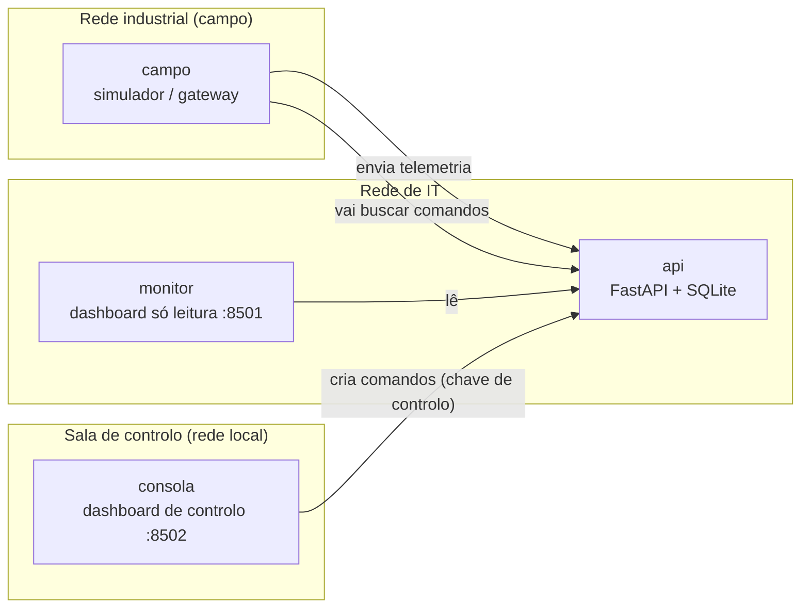

# Digital Twin & Telemetria Offshore — Blocos 17 e 32

Sistema de monitorização em tempo real para poços de petróleo offshore, com
deteção de anomalias, comandos de atuação auditados e separação entre a rede
de monitorização e a sala de controlo.

A arquitetura foi pensada para operações de águas profundas como os Blocos 17
e 32 de Angola. Funciona em dois modos:

| Modo | Dados | Para que serve |
|---|---|---|
| `simulacao` (por defeito) | Três poços fictícios (`B17-A`, `B17-B`, `B32-C`) com um modelo físico simplificado | Demonstração em tempo real, alertas e comandos |
| `volve` | Replay dos dados reais de produção do campo Volve (Equinor) | Validar o sistema com dados reais |

> **Nota:** este é um projeto pessoal e académico. Não tem relação com
> nenhuma operadora e não usa dados confidenciais. Os parâmetros da simulação
> são plausíveis, não reais.

---

## Arquitetura



Decisões de desenho:

- **O campo liga-se para fora, nunca o contrário.** O gateway envia as
  leituras e vai buscar os comandos pendentes. A API não abre ligações para a
  rede industrial.
- **Monitorizar e controlar são coisas separadas.** O dashboard de
  monitorização não tem botões nem chave de controlo. Só a consola, presa a
  `127.0.0.1`, pode criar comandos. Num ambiente real, o monitor seria
  publicado atrás de uma camada de acesso como o Cloudflare Access, e a
  consola nunca sairia da rede local.
- **O histórico nunca é alterado.** Um comando muda o estado do poço; as
  leituras seguintes refletem essa mudança. Cada comando fica registado com
  operador, estado e hora de execução.
- **A API decide o estado de segurança.** O emissor não pode marcar uma
  leitura como "OK".

## Componentes

| Ficheiro | Função |
|---|---|
| `app/main.py` | API REST: telemetria, histórico, comandos com auditoria, retreino do modelo |
| `app/physics.py` | Modelo físico do poço: pressão com inércia, picos, choke, caudal e temperatura relacionados, válvula de alívio |
| `app/simulator.py` | Gateway de campo: modo simulação ou replay do Volve |
| `app/volve.py` | Leitor do ficheiro de produção do Volve |
| `app/ml_engine.py` | Deteção de anomalias com Isolation Forest |
| `app/dashboard.py` | Dashboard Streamlit, em modo monitorização ou consola de controlo |
| `app/config.py` | Configuração por variáveis de ambiente e regra de segurança única |
| `app/models.py`, `app/database.py`, `app/schemas.py` | Base de dados e contratos de dados |
| `tests/` | Testes automáticos (pytest) |

## O modelo físico

Não é um simulador de reservatório, mas os dados comportam-se de forma credível:

- A pressão na cabeça do poço aproxima-se gradualmente de um valor de
  equilíbrio, sem saltos impossíveis.
- Surgem picos ocasionais de pressão (por exemplo, golfadas de gás) que
  decaem com o tempo. `B17-B` é o poço mais estável; `B17-A` e `B32-C`
  chegam por vezes à zona crítica.
- O caudal depende da abertura do choke e da pressão disponível, e a
  temperatura acompanha o caudal.
- **Aliviar pressão** abre uma válvula de alívio durante 20 passos: a pressão
  desce gradualmente e cerca de 30% do caudal é desviado.

Limites por defeito: atenção acima de 135 bar, crítico acima de 150 bar.

## Deteção de anomalias

As regras de limite só veem "pressão acima de 150 bar". O Isolation Forest
aprende o comportamento habitual do conjunto pressão, temperatura e caudal,
e marca combinações invulgares, como pressão normal com caudal muito baixo.
O modelo é treinado na consola de controlo (botão "Retreinar") com os dados
da base de dados, e a partir daí cada nova leitura é avaliada.

---

## Como executar

### Com Docker (recomendado)

```bash
git clone https://github.com/eduardovianga23-j/telemetria-offshore-project.git
cd telemetria-offshore-project
cp .env.example .env        # e troque as chaves de API
docker compose up --build
```

| Serviço | Endereço |
|---|---|
| Dashboard de monitorização | <http://localhost:8501> |
| Consola de controlo (só nesta máquina) | <http://localhost:8502> |
| Documentação da API (Swagger) | <http://localhost:8000/docs> |

Para testar um alerta: espere que um poço entre na zona crítica (vermelho)
e use "Aliviar pressão" na consola. O comando aparece no "Registo de
comandos" como `PENDENTE` e, segundos depois, como `EXECUTADO`.

### Comandos do dia a dia

Corra-os na pasta do projeto. Antes, abra o Docker Desktop e espere por "Engine running".

| Para... | Comando |
|---|---|
| Ligar tudo em segundo plano | `docker compose up -d` |
| Ligar tudo e o túnel da Cloudflare | `docker compose --profile publico up -d` |
| Ligar depois de alterar o código | `docker compose up --build -d` |
| Ver o estado dos serviços | `docker compose ps` |
| Ver os logs em direto (Ctrl+C para sair) | `docker compose logs -f` ou `docker compose logs -f api` |
| Ver o endereço atual do túnel | `docker compose logs tunel \| grep -i trycloudflare.com \| tail -1` |
| Desligar só o túnel | `docker compose stop tunel` |
| Desligar tudo (os dados ficam guardados) | `docker compose --profile publico down` |
| Desligar tudo e **apagar** os dados | `docker compose --profile publico down -v` |

Se arrancou com `docker compose up` sem `-d`, os logs ficam no terminal e
`Ctrl+C` desliga o sistema.

### Sem Docker

```bash
python -m venv .venv && source .venv/bin/activate
pip install -r requirements-dev.txt
uvicorn app.main:app --port 8000                  # terminal 1
python -m app.simulator                           # terminal 2
streamlit run app/dashboard.py                    # terminal 3 (monitorização)
CONTROLO_ATIVO=true API_KEY_CONTROLO=dev-controlo \
  streamlit run app/dashboard.py --server.port 8502   # terminal 4 (consola)
```

### Testes

```bash
python -m pytest -v
```

O CI do GitHub Actions corre os testes, constrói a imagem Docker e confirma
que a telemetria chega à API.

---

## Publicar o monitor na internet (Cloudflare)

O serviço opcional `tunel` publica **apenas o dashboard de monitorização**
com um Cloudflare Quick Tunnel:

- O contentor abre uma ligação **de saída** para a Cloudflare: não se abrem
  portas no router nem se expõe o computador.
- Só entra quem tiver um e-mail da lista `ACESSO_EMAILS` (no `.env`), com um
  código de uso único enviado para esse e-mail.
- A consola de controlo **nunca** é publicada: continua presa a `127.0.0.1`.

```bash
docker compose --profile publico up -d
docker compose logs tunel     # procure o endereço https://....trycloudflare.com
```

Limitações dos Quick Tunnels: o endereço é temporário (muda a cada arranque) e
não há garantia de disponibilidade. Para um endereço fixo, o passo seguinte é
um túnel com nome no Cloudflare Zero Trust, com um domínio próprio e uma
política de Access.

---

## Modo Volve (dados reais)

1. Descarregue os dados do Volve na página da Equinor:
   <https://www.equinor.com/energy/volve-data-sharing>
2. Copie o ficheiro de produção diária (CSV ou Excel) para a pasta `data/`.
3. No `.env`, defina `MODO_DADOS=volve` e `VOLVE_NOME_FICHEIRO=<nome do ficheiro>`.
4. Se a pressão dos poços do Volve for diferente da simulação, ajuste
   `LIMITE_ATENCAO_BAR` e `LIMITE_CRITICO_BAR`.
5. `docker compose up --build`

Os dados são diários; o gateway reproduz um dia real a cada intervalo, com
a data original. No modo Volve, os comandos estão desativados, porque são
dados históricos.

**Licença e atribuição:** dados do campo Volve disponibilizados pela Equinor
e pelos parceiros da licença, sob a Equinor Open Data Licence. Uso não
comercial. Os dados não são redistribuídos neste repositório.

---

## Próximos passos

- TimescaleDB para séries temporais
- MQTT entre o campo e a API
- Prometheus e Grafana para métricas do próprio sistema
- Túnel com nome e domínio próprio no Cloudflare Zero Trust (endereço fixo e políticas de Access)
- Infraestrutura como código (Terraform) em AWS e Azure

## Tecnologias

Python 3.13 · FastAPI · SQLAlchemy · Streamlit · Plotly · pandas ·
scikit-learn · Docker Compose · GitHub Actions · pytest
